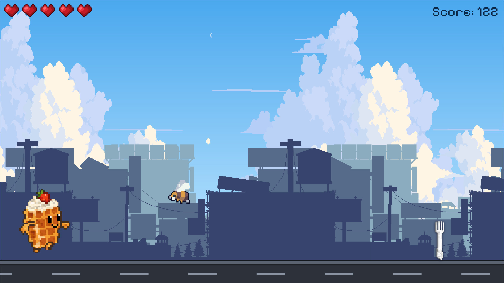
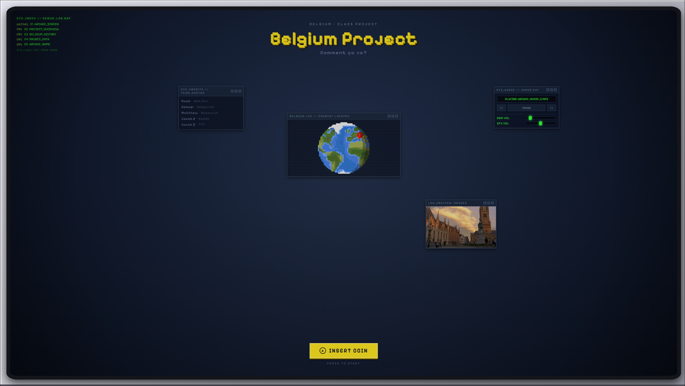

<div align="center">

  <h1>BELGIUM GEO PROJECT</h1>

  <p>
    <b>An interactive retro-arcade country fair project featuring a multi-terminal showcase and a quiz-based side-scroller mini-game.</b>
  </p>
  <p>
      <a href="https://belgian.netlify.app/"></a> 
      <a href="https://arch-devnix.github.io/belgiumproject/"></a> 
      <a href="https://github.com/arch-devnix/belgiumproject/"></a>
  </p>
  <p>
    <!-- Netlify Deploy Status Badge -->
    <a href="https://app.netlify.com/projects/belgian/deploys"></a>
  </p>
  <p><em>💡<b>Hosting Note:</b> Netlify runs on a credit-based system, which means at some point my pushes will fail to deploy for the current cycle. Check the status badge above to see if it's up to date (if it says failed, Netlify is still serving older files). GitHub Pages is recommended for the most up-to-date live version.</em></p>
  <br />

  
  

</div>

<br />

## About The Project

A school project built for an upcoming country fair under a tight deadline. While PowerPoint was the standard choice for most, I decided to push myself out of my comfort zone and build an interactive retro arcade web app from scratch.

> **Developer Note:** This is my 4th JavaScript project. I chose not to use a game framework (like Phaser, PixiJS, or Excalibur) so I could maintain total control over the code, this proved rather painful; causing me potential lasting psychological scars and a broken keycap.

<br />

## Features & Highlights

- **Retro CRT Arcade Interface:** A 2.5D arcade casing with scanlines, a CRT "power-on" boot effect, an RGB-split title glitch, and draggable multi-terminal windows (Globe, Bruges preview, Credits roster, and Jukebox) that "lift" while being dragged. On smaller screens, some panels are hidden so nothing overlaps.
- **Custom GSAP Cursor:** A pixel-box cursor that reacts to what it's over: it wraps around buttons, labels links, frames images, shows a live volume % on the sliders, and pops up a Belgian fries sprite on a hidden easter egg.
- **Animated Intro Slide:** Text reveals, counting stats, and a 3D tilt-and-glare effect on the featured image.
- **Custom Slide System:** Arrow-key and swipe navigation between slides, with a pixel-style progress indicator.
- **Multi-Track Audio Jukebox:** Selectable background tracks, custom pixel-styled volume sliders (BGM & SFX), and smooth audio crossfading/ducking during trivia transitions.
- **Interactive Quiz Side-Scroller:** Jump, dive, and dodge obstacles (forks and bees) while managing your health (hearts). Colliding shakes the screen and triggers timed trivia questions in an arcade terminal popup, complete with custom quiz music and audio feedback (`rightanswer.mp3`, `wronganswer.wav`).
- **Mobile Supported (Desktop Recommended):** Touch-screen swipe support and on-screen game controls for mobile devices.
- **Parallax Effect:** Layered background scrolling for immersive visual depth.
- **Pixel Art:** Pixelated art animations generated from sprite sheets.
- **Accessibility:** Visible keyboard focus outlines, and animations are toned down or disabled when the system's reduced-motion setting is on.

<br />

## Design Choices

When I heard a country fair was coming up and a presentation was due for each term, I decided I was going to make a website with the core idea being a side-scroller to add interactivity for the class. Then, I realized if I was going to make a website, I wouldn't have native PowerPoint capabilities like sliding motions and transitions, so why not just make my own "system" with simple JS (moving to another `.slide` index based on arrow keys pressed)? I then added nice CSS animations. 

### 1. Engine & Visual Architecture
Now that I had all of that done, I realized that the game looked incredibly boring. I used static sprites and the original canvas didn't even fill the screen, so I added animated sprites, parallax effects, and also improved object spawning by implementing a weighted bag randomizer paired with a compound pattern queue, followed by simple physics-based procedural spacing. I decided not to use object pooling because the ROI wasn't worth it; my current system was working efficiently due to JS's already amazing garbage collection. 

### 2. Retro CRT UI & Immersion
Later, I got bored after coming back from an activity so I just decided to lock in and give the web app a nice retro terminal look with scanlines and draggable terminal windows. My favorite part was the 2.5D arcade casing, and I chose to implement that because I really wanted the class to feel immersed, and a low-cost way to do that was in fact the casing. Once that was done, I added music, SFX, and nice touches.

### 3. Technical Challenges & Balancing
The most difficult part—aside from not using a game framework or engine—was actually the randomized-bag weighted spawner paired with the physics-driven dynamic gap calculation because they had to balance two things: randomness and strict fairness. My bag randomizer was designed to provide variety, yet the physics math had to act as a "warden," one could say. I needed fun layouts while also considering the fact that every single combo needed to be mathematically beatable.

### 4. Personal Takeaways
I learnt a lot from this project. I learnt not just the syntax of JS, but it actually helped me grow as a dev as a whole. There are so many aspects of making enjoyable or non-trivial programs that I never even considered at the start of my development journey. Going into this, I didn't ever realize I was going to be tracking the location of each cell of a sprite sheet on a heavily enclosed pixelated globe that I took online. I learnt various things such as pixel art, UX, algorithms, organization, and more. I hope to keep growing as a developer!...

<br />

## Built With

<p>
  
  
  
  
  
  
</p>

> GSAP is used only for UI animation (custom cursor, intro slide effects). The game itself runs on plain Canvas 2D with no framework.

<br />

## Run Locally

Clone the project and open it through a local server (recommended so asset paths resolve correctly; VS Code Live Server also works):

```bash
# Clone repository
git clone https://github.com/arch-devnix/belgiumproject.git

# Navigate to project directory
cd belgiumproject

# Launch local server (choose one)
npx serve                # Node.js
python3 -m http.server   # Python 3
```

Then open the URL printed in the terminal (e.g. `http://localhost:3000` for `npx serve`, `http://localhost:8000` for Python).
